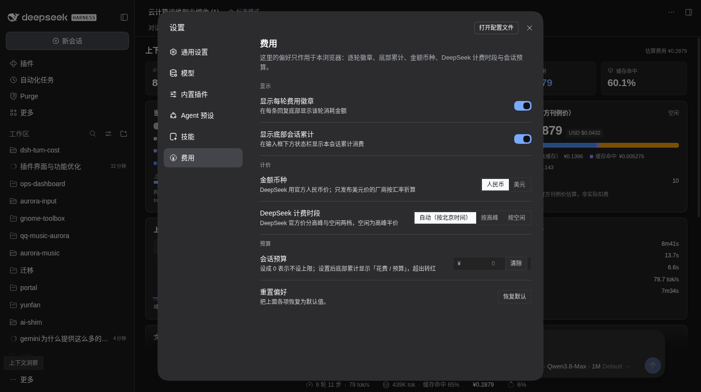
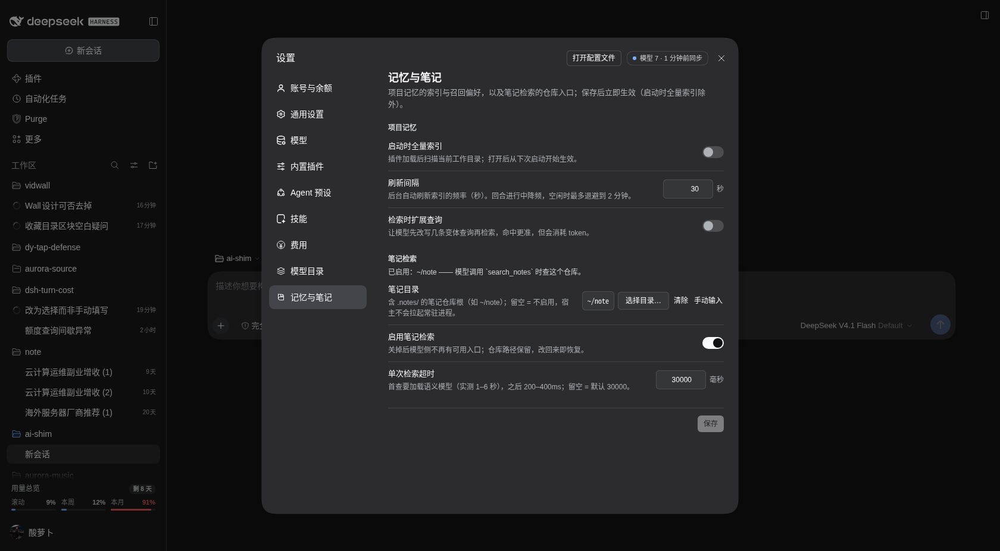

# dsh-session-insight

[](https://github.com/yib0601/dsh-session-insight)
[](https://github.com/topics/dsh-plugin)
[](package.json)

> DSH 插件（`dsh-plugin`）。标签：`dsh` · `dsh-plugin` · `deepseek-harness` · `deepseek` · `plugin` · `cost-tracking` · `context-inspector` · `subscription-quota` · `model-catalog` · `project-memory`

给 [DeepSeek Harness](https://github.com/deepseek-ai/deepseek-harness)（DSH）Web 端补齐「一个会话该看见自己的那部分」：**钱**（按官方单价逐轮算费）、**上下文**（`174K` 拆到每个工具与每段提示词）、**额度**（订阅还剩多少、几天后重置）、**模型目录**（自建网关的清单跟随上游），以及**跨轮跨会话的记忆与笔记**（项目记忆引擎 + 笔记检索）。

名字里的 `insight` 是字面意思：这个包只做一件事——把一次会话里看不见的东西变成看得见的数字与条目（费用、上下文、额度、模型目录、项目记忆、笔记），六块各自成模块、装配期互不引用。

- 逐轮徽章：每个 assistant 动作后面跟一枚金额徽章，点开看 input / cacheRead / cacheWrite / output 四个 token 桶各花了多少
- 底部会话累计：状态栏一枚药丸显示本会话累计花费；设了预算后显示 `花费 / 预算` 与进度条，超支转红
- 币种 CNY（默认）/ USD 可切：CNY 优先用厂商官方人民币行，缺省按汇率折算并标 `fx`
- DeepSeek 峰谷分时计价：历史金额按请求发生时刻落档，不按「现在」重定价
- 用量总览：跨会话仪表盘（KPI、构成、环形图、趋势、模型花费榜、7 日双指标、周对齐热力图）、会话「上下文」页签、`/context` 命令弹窗、右侧栏 Context 页签、Agent 家族卡（上下文页内）、逐请求浏览器（筛选 / 排序 / CSV / 分页）
- 上下文明细：「上下文」页新增一张卡，把「已用 174K」拆到条目——**每个工具定义**各自的估价（86 个工具不再是一个匿名 17K）、**系统提示词分区**（按标题 / `【…】` 标签 / 三段式 banner 切分，逐区估价 + **点开读完整正文**）、**消息构成**（用户输入 / 助手回答 / 助手思考 / 工具参数 / 工具结果，各给条数与占比）、**占用最大的 24 条**（带工具名、轮次与预览）；每行都能展开读正文；卡内三个页签 + 名称/内容搜索 + 按大小/名称排序。**四层视觉层级**：整窗摘要条（三段占比与图例）→ 带条目计数徽标的页签 → 本页签量级行（总量 / 占上下文 / 条目数，附搜索与排序）→ 带列头的条目行（名称 · 一行摘要 · 量级条 · tokens · 占比，头名行加强、其余淡出）；数字各有分母，窄到右栏宽度自动收起摘要列与量级条。三项合计与 DSH 内置 `contextBreakdown` 逐项相等（同一会话日志实测 `8104 / 17129 / 356622` 完全一致），不是另一套口径，只是把同一笔账拆开
- 订阅额度 + 到期倒计时：侧栏脚「用量总览」是一条两行卡片——第一行标题右侧是「剩 12 天」倒计时（取最长额度窗口的重置时刻，≤7 天转黄、≤3 天转红），第二行是 5 小时 / 周 / 月三条微型计量条；侧栏折叠时收成一枚「54% / 12天」小方块。按请求的 **provider id** 自动选源（同名的 `deepseek-v4.1-flash` 可能由 DeepSeek 官方、OpenCode 或 `ai-router` 服务，只有 provider 说明是谁的订阅在扣）：OpenCode Go 给三档用量窗口，DeepSeek 给账户余额（充值 / 赠送拆项在悬浮明细里）；改模型立即换源；自建网关（如 `ai-router`）按上游密钥计费、网关自身不设配额，卡片只写「此供应商无额度可查」而不显示任何数字、也不发额度请求——**除非网关自己说得清**：`ai-shim` 的 `/v1/models` 每行带 `quota.source`（由该行的 `backends` 判定「哪份订阅在扣」），插件的 Host 在同步模型清单时把它一并收起、随 `/dsh-session-insight/models` 发给页面，脚标签源**先读这张表**（按 provider 路由隔离，同名模型在别的 provider 上不串），显示名里的平台段只作兜底；`quota.source` 为 `null`（`mixed` 多订阅行 / 读不到额度）才是真的留白。配了 `DSH_SESSION_INSIGHT_GATEWAY_URL` 时额度也由网关代读（`GET /v1/quota?backend=<id>`，Bearer 用 `AI_ROUTER_API_KEY`）：网关本来就持有 WorkBuddy 账号令牌、也本来就是这台机器唯一在说话的对端，于是本机不需要 shim 隧道、也不需要逐个供应商的密钥；网关读不到时**逐源回落到**原来的直连端点，不让一次网关抖动把数字抹掉。认不出供应商同样留白而不是猜一个源。仪表盘磁贴主数字是最紧那档、副行是倒计时。**先画上次读数再静默回填**：每次成功读数按源缓存在 `localStorage`，刷新页面 / chunk 重载时立刻显示上次的数字而不是「读取中…」，后台再静默读一次覆盖它（缓存 5 小时过期，任一窗口已重置即作废）；读失败时保留旧数字并标注「正在后台重试」，轮询 5 分钟一次，标签页回到前台或网络恢复时也补读一次。Host 侧读密钥、按源 5 分钟缓存，页面拿不到密钥
- 模型清单自动同步 + 「模型目录」页（自建网关）：`ai-router` 这类 **pi-ai 内置目录之外的 provider 路由**在 DSH 里没有运行时模型目录——profile 里声明的 `models` 就是模型选择器。插件在**你查看模型时**（设置面板一打开，或点进「设置 → 模型目录」）先画上次的清单、再在后台静默核对网关，核对结果有变化才写回；同一窗口内不重复打网关。核对时逐行生成条目（显示名 `<平台> · <计费> · <名字> · <窗口>` / `<名字> · <计费>自动降级`、输入模态、上下文与输出上限、思考档位与两个 `anthropic-messages` compat 开关），与已存清单逐条比较，**只在不一致时**经 DSH 的 `settings` 服务整体写回（校验条目 + 落盘 profile + 重建 provider 一个事务，不打任何 DSH 补丁、不改 `node_modules`、不直接写 profile 文件）。拉取失败 / 清单为空 / 显示名越界（含 router 历史标记）一律保持旧清单；行上没声明的模态与档位不补不猜。状态与手动触发：`GET /dsh-session-insight/models[?force=1]`。零配置，环境变量见下
- 项目记忆（原 `dsh-project-memory` 合成一个插件）：给会话一套**跨轮跨会话的长期记忆**——经验条目（lesson `问题 → 修法`、decision `选了什么 + 为什么`、procedure 步骤、experience 记录）、以及带步骤与热文件的任务记录。语料索引层（文档 chunk + 代码符号）不启用（`corpusEnabled: false`）：代码结构由 codegraph 提供、笔记语料由 `search_notes` 提供。每步可选静默注入一段记忆（entry 常驻块 + 相关性门控 + 单会话预算；同一条不重发），召回按 BM25（可选 leanvec 向量层重排）跨三层检索；写入侧做近重复检测与分层强化、超容量归档。**9 个工具**（`list_tasks` / `select_task` / `archive_task` / `show_task_panel` / `query_memory` / `remember` / `forget` / `save_lesson` / `pm_stats`；`index_doc` / `index_repo` / `watch_repo` 仅在 `corpusEnabled: true` 时注册）+ 唯一命令 `/tasks`（裸 `/tasks` 给任务清单快照，动作由面板按钮驱动）+ 宿主 skill `project-memory`。界面是懒加载的第三个 chunk：任务面板（`shell.overlay` 浮层，任务页 / 记忆页 / 新建表单 / 分页）、`/tasks` 的命令节点、`show_task_panel` 的工具视图、`/` 菜单的「工作流」组，以及「设置 → 记忆与笔记」页（项目记忆清单：只读，每条可展开看全文、涉及的文件与符号、触发条件与条目 id；记忆规模只留单轮注入预算一行；笔记检索三项）。索引与召回全本地；数据落在项目根的 `.dsh-project-memory/`，家目录 / 系统目录默认拒绝当根
- 笔记检索（`search_notes` 工具）：把原来那个独立 MCP 服务（`mcp__search-notes__*`）收进同一个包——内核仍是笔记仓库里的 `search_core.py`（section 级 BM25F + 语义 RRF 融合 + 中文别名 + 相关性策略），Node 侧只是一条常驻桥（`host/notes/bridge.py`，行分隔 JSON）。进程**惰性启动**：第一次真正检索才 spawn，语义模型常驻约 1GB，所以「没配目录」时连进程都不拉。失败**不装成空结果**——没命中和没装好在模型眼里长得一样，会把换词搜索变成空转，所以工具如实报错并回传 `mode=hybrid|degraded`。配置在「设置 → 记忆与笔记 → 笔记检索」：**笔记目录**（含 `.notes/` 的仓库根，留空 = 不启用；点「选择目录」直接挑——宿主装配原生选择器时弹系统文件夹对话框，装配内嵌浏览器时弹站内目录树，两条路都不用手打路径，「手动输入」只是兜底）、**启用笔记检索**、**单次检索超时**，三个字段都是 volatile，保存即生效（目录一变就换掉常驻进程，不用重启会话）；解释器与预热只留在 profile 的 `notes.python` / `notes.warmup`
- 费用偏好、预算、显隐开关全在插件自有设置页，`localStorage` 本地持久化

| 逐轮徽章 | 会话累计与预算 |
|---|---|
|  |  |

| 上下文页签 | 设置页 |
|---|---|
|  |  |

| 上下文明细（点开任一条读正文：提示词某一段、某个工具的真实 schema） |
|---|
|  |

| 「设置 → 记忆与笔记」：项目记忆清单（只读，带容量占用，每条可展开看全文 / 涉及的文件与符号 / 触发条件 / 条目 id）→ 记忆规模（只留单轮注入预算一格）→ 笔记检索（目录 / 开关 / 超时）；下图摄于笔记检索一栏 |
|---|
|  |

| 订阅余额（侧栏脚 + 仪表盘磁贴） |
|---|
|  |

更多截图见 [`docs/shots/`](docs/shots/)。

## 安装

插件以 `link:` 方式挂进 DSH profile（改完源码重启即生效，无需发版）：

```bash
git clone https://github.com/yib0601/dsh-session-insight.git
cd dsh-session-insight
dsh plugin --profile web add "link:$PWD"
```

装完重启 `dsh web`。

模型清单同步零配置即开（默认同步 `ai-router`、每 10 分钟一轮、启动 20s 后首轮）。需要改时用环境变量：

| 变量 | 默认 | 作用 |
|---|---|---|
| `DSH_SESSION_INSIGHT_MODEL_SYNC` | 开 | `0` / `off` 关闭整个循环 |
| `DSH_SESSION_INSIGHT_MODEL_ROUTES` | `ai-router` | 逗号分隔的 provider 路由（`llm-pi-ai` 的 `providers` 键） |
| `DSH_SESSION_INSIGHT_MODEL_SYNC_MS` | `600000` | 兜底轮询间隔（毫秒）；设 `0` 即完全不轮询，只在查看模型时核对 |
| `DSH_SESSION_INSIGHT_MODEL_BOOT_MS` | `20000` | 首轮延迟（毫秒） |
| `DSH_SESSION_INSIGHT_MODEL_STALE_MS` | `300000` | 读请求认定「缓存过期、该后台核对」的年龄 |
| `DSH_SESSION_INSIGHT_SETTINGS_NS` | `llm-pi-ai` | 承载 `providers` 的 settings 条目 id |
| `DSH_SESSION_INSIGHT_GATEWAY_URL` | 空（关闭） | 自建网关根地址（如 `https://ai.lighthouses.top`）。设了就先读 `GET /v1/quota?backend=<id>` 拿额度，读不到再回落到各供应商直连端点 |
| `DSH_SESSION_INSIGHT_GATEWAY_KEY_REF` | `AI_ROUTER_API_KEY` | 读网关用的凭据引用（与 `ai-router` provider 的 `apiKeyEnv` 同一把钥匙） |
| `DSH_SESSION_INSIGHT_GATEWAY_BACKENDS` | 见下 | `源=后端` 逗号表，覆盖「哪份订阅问网关的哪个后端」；写空值即停用该源的网关读取 |
| `DSH_SESSION_INSIGHT_WORKBUDDY_QUOTA_URL` | `http://127.0.0.1:8898/quota` | 未配网关时 WorkBuddy 额度的直连地址（本机是那条常驻 SSH 转发） |

`DSH_SESSION_INSIGHT_GATEWAY_BACKENDS` 的默认映射（右侧是 `ai-shim` 的 `router.json` 后端 id）：
`workbuddy=workbuddy`、`opencode-go=oc-go`、`deepseek=deepseek-official`。

`package.json` 里的 `dsh.compatibility.dshReleases` 声明了已适配的 DSH 版本（0.2.2-rc.2 至 rc.5）。

## 结构

| 文件 | 角色 |
|---|---|
| `index.js` | Host 入口：注册 3 个 `tc*` session 投影（timeline / headers / activity）、额度路由、模型清单同步，注册 `search_notes` 与它的常驻笔记桥（目录变了热切换），并挂载项目记忆引擎（各块各自 try/catch，一块失败不连坐另一块） |
| `src/memory/` | 项目记忆 Host 半边（64 个文件，按职责分目录）：`chunker` / `doc-index` / `index-pipeline`（索引）· `recall` / `vector-index` / `similarity`（三层检索 + 可选向量重排）· `auto-inject` / `inject-visible`（每步注入与预算）· `insight-store` / `store`（经验实体与落盘）· `watch` / `lazy`（增量与懒索引）· `tools/` · `commands/` · `util/` |
| `skills/project-memory/` | 宿主 skill（`SKILL.md` + `scripts/pm-digest.mjs` 体检脚本 + `scripts/pm-insights-sweep.mjs` 反思草稿审核提升），随包发布 |
| `host/schema.js`、`host/fold.js`、`host/projections.js` | Host 侧折叠：token 桶、峰谷分档、命令 / 文件 / 工具调用流水（纯 Node，防御式） |
| `host/model-sync/` | Host 侧模型清单自动同步（缓存优先：读用已存清单应答，stale 时后台核对）：`naming.js`（显示名语义与幂等剥壳）· `catalog.js`（行 → DSH 条目）· `listing.js`（拉取与解析 `/v1/models`）· `sync.js`（比较与写回策略）· `mount.js`（settings/credentials/定时/状态路由） |
| `host/notes/` | 笔记检索的 Host 半边：`provider.js`（配置解析 + 常驻子进程桥 + 崩溃退避）· `bridge.py`（进 Python 的唯一入口，一条 JSON 进一条 JSON 出）· `tool.js`（`search_notes` 工具定义与输出格式） |
| `client.js` | Client 入口：官方价目表与算价纯函数、本地偏好 store、徽章 / 药丸、槽位注册 |
| `client.context.js` | 懒加载 chunk：仪表盘、上下文页签（含 Agent 家族卡）、`/context` 弹窗 |
| `client.memory.js` | 项目记忆与笔记检索的懒加载 chunk（由 `client-memory-src/` 的 29 个模块按宿主 `__ModuleLoader__` 协议装配；`node scripts/build-memory-bundle.mjs` 重写模块表并 touch 入口，宿主 HMR 才会重载）：任务面板、`/tasks` 命令节点、`show_task_panel` 工具视图、`/` 菜单「工作流」斜杠源、设置页「记忆与笔记」（记忆清单 + 记忆规模一行 + 笔记检索三项） |
| `scripts/build-memory-bundle.mjs` | 把 `client-memory-src/` 的 ESM 模块装配进 `client.memory.js` 的模块表（只重写表体，手写的头尾装配代码一字不动） |
| `locale/{zh,en}.json` | 两个 locale 命名空间 `turnCost` / `tcContext` |
| `contracts/modules.yaml` | 模块契约（负责 / 不负责 / 对外暴露） |
| `test/` | `node --test test/`，价目表、Host 折叠/额度/模型同步的纯函数与路由测试，模型目录页的渲染与缓存优先行为测试（`model-catalog-client.test.js` 用桩 React 直接执行组件与 store），以及笔记检索与记忆那几组：配置解析 / 换桥指纹 / `notes.*` 的 volatile 契约（`notes-provider.test.js`）、嵌套路径写入（`notes-settings.test.js` / `memory-settings.test.js`）、清单占用口径（`memory-inventory.test.js`）、设置页渲染与文案 key（`settings-section.render.test.js`，桩 React 解析钩子见 `test/fixtures/`） |

设计取舍、数据契约（读哪些投影字段、封顶多少条）见 [`docs/ARCHITECTURE.md`](docs/ARCHITECTURE.md)；价目表与峰谷规则见 [`docs/PRICING.md`](docs/PRICING.md)；功能细节见 [`docs/DETAIL.md`](docs/DETAIL.md)。

## 测试

```bash
node --test test/
```

## 边界

只用官方价目表（不采信 models.dev 之类第三方价格）；只换算 DSH 已经折叠好的 token 用量，不重算、不改写会话日志、不 append 任何 session 事件；不统计联网搜索 / OCR 等按次计费项；上下文浏览器里的「请求内容」只渲染页面内存中的聊天快照，关页即消失。
